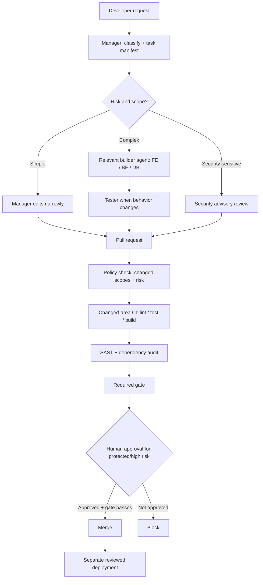
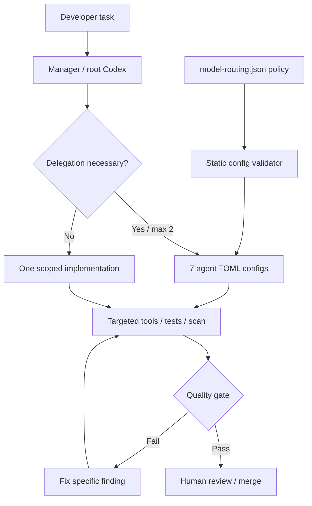

# ManagerHR | Agent governance and CI/CD

## Clear division of authority

| Layer                           | What it can guarantee                                 | What it cannot guarantee                                                |
| ------------------------------- | ----------------------------------------------------- | ----------------------------------------------------------------------- |
| AGENTS.md / TOML                | Requests consistent agent behavior                    | OS-level permission enforcement                                         |
| Task manifest + policy_check.py | Declared PR scopes and risk flags match changed paths | Which AI process made the actual edits                                  |
| CI                              | Actual commands and tests ran (if configured)         | Absence of all vulnerabilities                                          |
| Branch Rulesets / CODEOWNERS    | Require reviewers and a passing check                 | Prevent repository admins from changing settings, depending on controls |
| Human reviewer                  | Decide high-risk exceptions and deployments           | Replace automated test evidence                                         |

## State transitions

`REQUESTED → SCOPED → IMPLEMENTED → VERIFIED → REVIEWED → MERGEABLE → DEPLOYED`

No transition to MERGEABLE on a failed/absent required-gate. High-risk tasks also need reviewer approval configured in GitHub Rulesets.

## Context-budget policy

1. Locate via file names, then targeted search; don't load full repo.
2. Pass to a subagent: task ID, scoped paths, 3-5 acceptance criteria, minimal diff, and tool findings summary.
3. Return from agent: paths, actionable findings, exact command/result, blockers. No full file echoes.
4. Reuse scanner and coverage artifacts. Never automatically ask AI to repeat deterministic CI checks.
5. Limit two concurrent subagents; no automatic retry loops.

## V4 model-routing overlay

Policy JSON is not executed by Codex. Runtime agent settings come from TOML; default profile inherits your signed-in client's model.
